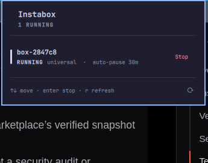

# Instabox

An Omarchy bar widget for [Instabox](https://instabox.sh) sandboxes: one label
shows what is running, and one panel lists every box with start, stop, and
resume actions.

```
▣ 1/2        bar label: running / total
```



Open the panel from the bar, or bind it like any other shell widget. While the
panel is open it refreshes every 2.5 seconds, so the state the server reports
(`starting`, `stopping`, …) is what you see. With the panel closed it polls
every 30 seconds by default.

## Panel

- **Hero** — the states that are present right now (`1 running`,
  `1 paused`, …). Absent states are left out, so it never opens with
  `0 running`.
- **One row per sandbox** — name, a state rail and label, the template, and
  (for a running box) its auto-pause window (`auto-pause 30m`, or
  `always on`), plus a single action:
  - `Stopped` → **Start**
  - `Running` → **Stop**
  - `Paused` (suspended) → **Resume**
- **Keyboard** — `j`/`k` or arrows move, `Enter` runs the row's action,
  `r` refreshes, `Esc` closes. The footer hints at the current row's action.
- **Quiet when asleep** — the bar mark dims while no box is running.
- The action button is disabled while the box is `Starting` or `Stopping`;
  failures appear inline in the panel.

The panel is a view over `instabox ls --json`. Nothing is cached to disk and
no state is written outside Instabox itself.

## Requirements

- `instabox` on `PATH` (`~/.local/bin/instabox` is found automatically by the
  shell).
- A signed-in CLI: `instabox whoami`, or `INSTABOX_API_KEY` in the shell
  environment. When the CLI is signed out, the panel shows the error and the
  bar mark dims.

## Install

From the marketplace:

```sh
omarchy plugin add ak127a/instabox --enable
```

Or copy the plugin into your shell config by hand:

```sh
cp -r . ~/.config/omarchy/plugins/ak.instabox
omarchy-shell shell rescanPlugins
omarchy plugin enable ak.instabox --section right
```

Move it with `omarchy bar move ak.instabox --section right --index 0`.

## Scripting

The widget registers an IPC target, so the panel and its actions can be driven
without touching the bar:

```sh
qs_ipc() { quickshell ipc -p "${OMARCHY_PATH:-/usr/share/omarchy}/shell" "$@"; }

qs_ipc call ak.instabox toggle            # open/close the panel
qs_ipc call ak.instabox refresh
qs_ipc call ak.instabox status            # JSON array of the boxes
qs_ipc call ak.instabox start work        # start by id or name
qs_ipc call ak.instabox stop  work
qs_ipc call ak.instabox resume work
```

Bind `ak.instabox toggle` in Hyprland for a keyboard-first panel (pick a combo
you do not already use):

```lua
o.bind("SUPER + SHIFT + I", "Instabox", "quickshell ipc -p /usr/share/omarchy/shell call ak.instabox toggle")
```

## Settings

Settings live on the widget's entry in `~/.config/omarchy/shell.json` (or via
the bar's widget settings):

| Key | Default | Meaning |
|---|---|---|
| `refreshIntervalSec` | `30` | Poll interval while the panel is closed (5–600) |
| `labelMode` | `Count` | `Count` shows `running/total`; `Icon` shows only `▣` |

Example:

```json
{ "id": "ak.instabox", "refreshIntervalSec": 60, "labelMode": "Count" }
```

## Uninstall

```sh
omarchy plugin disable ak.instabox
rm -rf ~/.config/omarchy/plugins/ak.instabox
```

## License

MIT. See [LICENSE](LICENSE).
